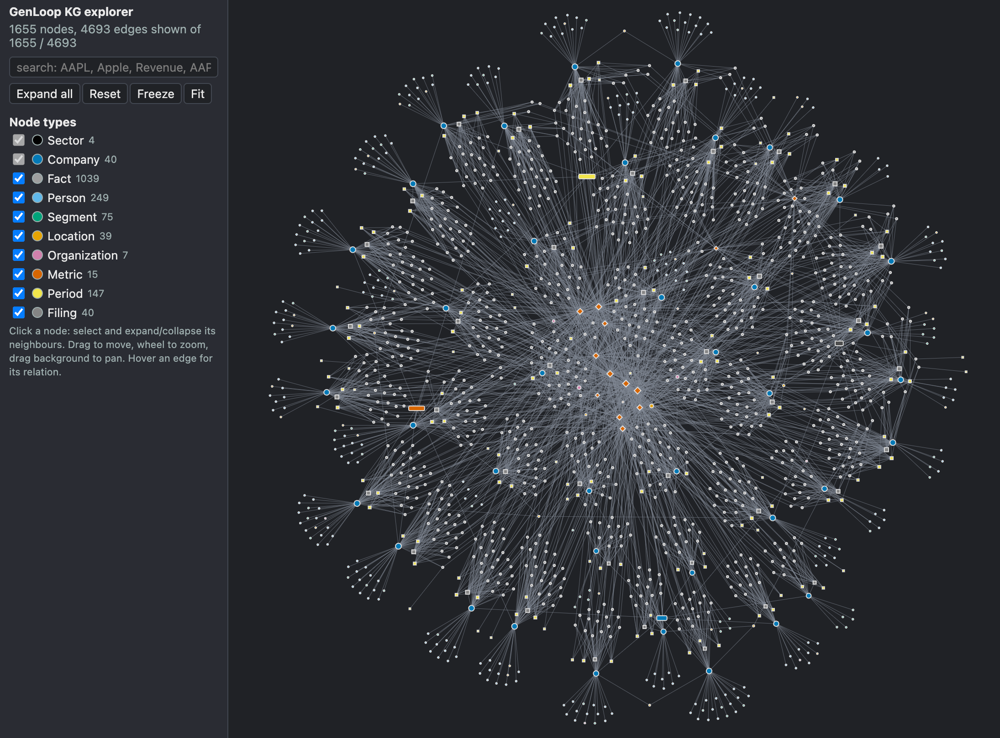

# GenLoop: 10-K knowledge-graph QA

Builds a knowledge graph from the latest 10-K of 40 US public companies (4 sectors x 10) and answers questions by traversing the graph, not by vector search. Every answer cites its document and PDF page, or abstains when the fact is not in the graph. Repo: https://github.com/bomb-rajas/genloop-10k-kg



*Sectors, companies, facts and entities. [Open the interactive explorer](kg-visualization/explorer.html) (single file, works offline).*

## Quick start

```bash
python -m venv .venv && .venv/bin/pip install -r requirements.txt
cp .env.example .env        # optional: GROQ_API_KEY, GEMINI_API_KEY (only needed to rebuild entities)
.venv/bin/python -m src.query "What was Apple's total net sales in fiscal 2026?"
.venv/bin/python -m src.evaluate     # reproduces the results below from graph/kg.json, no keys
.venv/bin/python -m pytest -q        # 266 tests
```

## Pipeline

| Step | Command | Output |
|---|---|---|
| 1. Download 10-K (HTML to PDF) + XBRL | `python -m src.download` | `data/pdfs`, `data/xbrl` |
| 2. Parse PDFs page by page | `python -m src.parse` | `data/parsed` |
| 3. Extract numeric facts from tables | `python -m src.extract` | `data/facts` |
| 4. Extract entities with an LLM | `python -m src.entities` | `data/entities` |
| 5. Build the graph | `python -m src.build_graph` | `graph/kg.json` |
| 6. Ask / evaluate | `python -m src.query "..."`, `python -m src.evaluate` | `report/` |

Plus `python scripts/render_kg.py` to regenerate the explorer.

## Repo map

| Folder | Contents |
|---|---|
| `config` | the 40 companies, metric definitions |
| `data` | `pdfs` (gitignored), `parsed` text, `facts` (numbers read from PDF tables), `entities` (people, auditor, HQ, segments extracted by LLM from text and grounded), `xbrl` (gitignored) |
| `graph` | `kg.json`, the built graph |
| `src` | pipeline, planner, query |
| `benchmark` | `benchmark.json` (59 questions with gold), `gold_review.md` |
| `report` | `metrics.json`, `per_question.csv` |
| `results` | `results.pdf` |
| `kg-visualization` | explorer and graph images |
| `scripts`, `tests` | report/render helpers, pytest suite |

## Results

59 questions, `report/metrics.json`: **53 correct of 58 scored** (1 has no checkable gold).

| | n | correct | accuracy (scored) | accuracy (all 59) |
|---|---|---|---|---|
| Overall | 59 | 53/58 | 91.4% | 89.8% |
| Single fact | 20 | 20/20 | 100% | 100% |
| Multi-hop | 20 | 15/19 | 78.9% | 75.0% |
| Cross-filing | 19 | 18/19 | 94.7% | 94.7% |

Precision 1.00, recall 0.99. 7 of 7 expected abstentions were correct.

Honest note: all 59 questions are in one file. Q30-Q59 were written after earlier planner fixes, and Q45-Q59 are the cleanest estimate: 12/15 correct (80%). Gold is AI-drafted and AI-reviewed (`verified: false`); a human should verify it.

## Known gaps

- Metrics such as GrossProfit, R&D and OperatingIncome are missing for companies that do not report them as a line item.
- Multi-hop questions are the weakest type (75% over all).
- Fiscal-year labels can shift for retailers with 52/53-week years.
- Only the latest 10-K per company, so no long time series.

## XBRL (validation only)

XBRL is the SEC's machine-readable copy of a filing's numbers. The task asks for PDF-only parsing, so XBRL is used only to check the PDF-extracted facts: a fact is flagged validated when it matches XBRL for the same period (983/983 compared match). XBRL never supplies an answer.

## AI tools and where I made the decisions

I decided what to build and the rules it had to follow; AI wrote the code.

- I wrote the project spec: the schema (Company, Sector, Filing, Fact, Metric, Period, Segment, Person, Org, Location), the fact ID format `TICKER|Metric|FY`, the 40 companies across 4 sectors, the folder layout and the timebox plan.
- I set the hard rules: parse PDFs only (EDGAR HTML converted to PDF with headless Chrome, never parsed for facts); XBRL only to validate, never to supply answers; answer by graph traversal, not vector search; free LLM tiers only; gold is never edited to fit output.
- I supplied the Groq and Gemini keys and chose Groq as primary with Gemini as fallback after testing which models worked.
- I set the process: AI works as Implementer and Verifier, review and test after each milestone, honest failure analysis, question selection disclosed.
- I asked for the blind second-model gold review and for the unseen questions (Q30-Q59), and approved the planner and parser fixes after seeing the failure diagnosis.
- I asked for the interactive KG explorer and the minimal results PDF, and published the repo.
- I will hand-verify the gold.

Tools: Claude Code (Claude Sonnet 5.5 orchestrating, Claude Haiku and Sonnet sub-agents writing code, Claude Opus for read-only audits and the blind gold review) wrote the code, tests and drafts of benchmark questions under those instructions. Groq gpt-oss-120b and Gemini flash-lite run inside the pipeline for entity extraction and the fallback planner.
