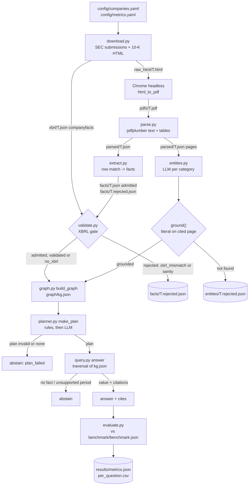

# GenLoop end-to-end flow (derived from src/, 2026-11-23)

Every path, function and threshold below was read from the code. GOAL.md is the spec; where they differ, the code wins.

## 1. Pipeline



Run order (each stage reads the previous outputs): `python -m src.download`, `src.parse`, `src.extract`, `src.entities`, `src.graph`, then `src.query` or `src.evaluate`. `src/validate.py` is called from `extract.py`, not run alone. `src/build_graph.py` is an alias of `src.graph.main`.

## 2. Stages

### 2.1 Download (`src/download.py`)
- Entry: `python -m src.download [--tickers]` -> `main` (line 161). Needs `SEC_USER_AGENT` in `.env` (missing -> `sys.exit`, message "SEC_USER_AGENT is missing from .env").
- Input: `config/companies.yaml` (via `src/config.py load_companies`), SEC submissions API, `companyfacts` JSON.
- Key functions: `Throttle.wait` (l45, MIN_INTERVAL 0.2 s), `http_get` (l55, RETRY_STATUS {429,500,502,503,504}, BACKOFF [2,4,8], TIMEOUT 120), `latest_10k` (l74, form exactly "10-K", max filingDate), `filing_url` (l90), `html_to_pdf` (l94, Chrome headless, CHROME_TIMEOUT 180), `is_balance_sheet` (l112: "total assets" AND one of total liabilities / total equity / shareholders / stockholders), `financials_page` (l118), `find_financials_page` (l124; skips first FIN_SKIP_FRAC=0.15 of pages), `process` (l133; skips when status in DONE and pdf exists).
- Outputs: `data/raw_html/T.html`, `data/pdfs/T.pdf` (the only document facts come from), `data/xbrl/T.json`, `data/filings.json` entry `{accession, filing_date, report_date, url, form, pdf, status (ok|no_financials|error), financials_page}`.
- LLM: none. Cache: none (re-runs skip DONE companies).
- Abstain/skip: `no_financials` status when no balance-sheet page is found.

### 2.2 Parse (`src/parse.py`)
- Entry: `python -m src.parse [--tickers] [--force] [--reuse-pages]`; `Pool(4)`.
- Input: `data/pdfs/T.pdf`. Output: `data/parsed/T.json` = `{ticker, n_pages, pages{"1": text, ...}, statements{income_statement|balance_sheet|cash_flow_statement: {pages, scale, scale_source_text, columns, newest_col, rows[{label, values, page}]}}}`.
- Thresholds: `MIN_VALUE_ROWS=10` (l41, value rows for a statement page), `MAX_CONTINUATION=2` (l42), `TABLE_FALLBACK_BELOW=5` (l43, pdfplumber `extract_tables` used only when text gives fewer rows).
- Key functions: `title_kinds` (l76), `is_statement_layout` (l89), `key_kinds` (l99), `find_statements` (l126), `_page_rows` (l152), `build_statement` (l162, scale from header; note column dropped), `parse_pdf` (l190), `run_company` (l211, atomic write via `.json.tmp`).
- Pure helpers in `src/tables.py`: `parse_number` (l19; "(1,234)" -> -1234, dashes -> 0), `find_scale` (l144; SCALE_RE l8; returns None when absent, never assumed), `pick_year_column` (l167).
- LLM: none. Cache: `--reuse-pages`.

### 2.3 Extract (`src/extract.py`)
- Entry: `python -m src.extract [--tickers] [--verbose]` -> `run` (l238).
- Input: `data/parsed/T.json`, `config/metrics.yaml` (synonyms, `load_metrics` keys: metrics, derived, helper_metrics, count_metrics).
- Output: `data/facts/T.json` (admitted, sorted) and `data/facts/T.rejected.json`. Fact id `f"{t}|{name}|FY{year}"` (`_fact` l215), fields include `validated`, `xbrl_status`.
- Thresholds: `STATEMENT_YEARS` (l15: income 3, cash flow 3, balance sheet 2; D-054), `GENERIC_EXCLUDE` (l16: margin, growth, change, percent, ratio, before, and; D-055).
- Matching (`match_row` l31): tiers exact -> regex -> prefix -> fallback exact/prefix. `find_metric_row` (l64).
- Fiscal-year alignment: `shift_of` (l94) maps labels to report year (D-058). CapEx stored as absolute (D-057). Identity fallback `sum(plus) - sum(minus)` in `extract_company` (l83).
- Calls `validate.gate` before writing (XBRL gate below). Prints XBRL match rate.
- LLM: none.

### 2.4 XBRL gate (`src/validate.py`; validation only, never fills values, D-016)
- Constants: `TOLERANCE=0.005` (relative, USD), `EPS_ABS_TOLERANCE=0.005`, `DATE_WINDOW_DAYS=7`, `FLOW_DAYS=(350,380)`, `IDENTITY_TOLERANCE=0.005`, `MAX_ABS_USD=1e13`, `MAX_ABS_EPS=1000.0`.
- Functions: `anchor_date` (l18), `xbrl_entries` (l27; 10-K FY entries, own accession preferred), `within` (l53), `gate_fact` (l59), `identity_check` (l80; TA = TL + Eq, logged only), `sanity_ok` (l100; Revenue and TotalAssets must be > 0), `gate` (l109).
- Outcomes: no matching XBRL entry -> `xbrl_status=no_xbrl`, admitted unvalidated (57 such facts in M5). Mismatch beyond TOLERANCE -> rejected `xbrl_mismatch`. Sanity failure -> rejected. Match -> `xbrl_status=match`, `validated=True`.
- Real numbers (M5): 1039 Fact nodes, 947 matched, 57 no_xbrl, 0 rejected.

### 2.5 Entities (`src/entities.py`; text facts, M4b)
- Entry: `python -m src.entities` -> `main` (l272); `--regate` re-grounds from cache only (no network; raises `CacheMiss`).
- Input: `data/parsed/T.json` pages. Output: `data/entities/T.json`, `data/entities/T.rejected.json`.
- Categories: `CATEGORIES` = cover, segments, employees, auditor, officers. `MAX_CHARS=6000` excerpt cap. `find_windows` (l69; employees and officers take the located page plus the next; auditor starts from the engagement sentence, `shortcut:` comment l76-77).
- LLM: one call per category via `ask` (l100), `SYSTEM` (l17), `SCHEMAS` (l22); on bad JSON one retry with `RETRY_NOTE` (l33). Goes through `llm.complete` (see section 3).
- Gate: `ground` (l118) requires the normalised value to appear literally on a cited page (`_literal_rx` l132); records page and a 60-char snippet. Only grounded rows are admitted (`run_company` l237).
- IDs: `entity_id` (l145) gives `PREFIX|TICKER|slug`, with PERSON, SEG, ORG, LOC prefixes; exchange names via `exchange_slug` (l157). Employees become Fact `{T}|Employees|FY{year}` (`validated=False`, relation EMPLOYS_COUNT).
- M4b result: 504 candidates, 488 admitted (96.8%), 16 rejected.

### 2.6 Graph (`src/graph.py`)
- Entry: `python -m src.graph` -> `main` (l196). Output `graph/kg.json` (node-link, edges key `"edges"`), asserted < 20 MB (1.11 MB at M5).
- Functions: `build_graph` (l94), `_add_fact` (l34; requires `FACT_REQUIRED = doc, page, value, unit, period, validated`), `_add_entities` (l74), `save_graph` (l143), `load_graph` (l150), `neighbors` (l155), `facts_of` (l161).
- Node ids: `TICKER`, `SEC|sector`, `M|metric`, `PD|T|FY|period_end`, `FIL|accession`, fact id. Edges: HAS_FACT, OF_METRIC, FOR_PERIOD, REPORTS, FILED, IN_SECTOR, COMPUTED_FROM. Derived metric values are not stored.
- Raises on doc mismatch, unknown metric, or duplicate id.

### 2.7 Planner (`src/planner.py`)
- Entry: `make_plan` (l280). Rules first: `rule_plan` (l137) returns `(plan, abstain)`; `check` (l216). If the rules give a valid plan, return it (no LLM call).
- Otherwise: `_llm_prompt` (l241), `LLM_SYSTEM` (l238), `llm.complete(json_mode=True)`. `validate_llm_plan` (l251) rejects unknown tickers, metrics or values. LLM failure -> abstain `plan_failed`.
- Lexicon: `METRIC_ALIASES` (l19), `ENTITY_PATTERNS` (l49), `MAX_RE` (l62), `MIN_RE` (l63), `Lexicon` (l76), `default_lexicon` (l108), `_years` (l127).
- Plan fields: intent, companies, sector, metric, metrics, years, op, growth, entity_rel, role, topn.

### 2.8 Query (`src/query.py`)
- Entry: `python -m src.query "<q>" [--json]` -> `main` (l254). `answer` (l199) loads the graph (`load_graph`), calls `make_plan`, then `numeric_answer` (l137) or `entity_answer` (l176); `finish` (l221), `show` (l243).
- Helpers: `spec_of` (l22), `fact_for` (l36; prefers validated), `resolve_fy` (l63; year not in graph -> abstain `unsupported_period` or `no_fact`), `company_value` (l78), `gather` (l121), `cite` (l106), `scope` (l111), `fmt` (l98). `DERIVED_EXTRA` (l13) computes OperatingMargin from OperatingIncome / Revenue.
- Abstain reasons: `Abstain` (l16) carries reason and detail; plan_failed, no_fact, unsupported_period.
- No LLM call on the numeric path when rules plan the question. No vector search and no XBRL read at query time.

### 2.9 Evaluate (`src/evaluate.py`)
- Entry: `python -m src.evaluate` (no key needed; uses cache). Reads `benchmark/benchmark.json` key `items`.
- `TOL=0.005` (l20), `SCALES` (l21), `numeric_ok` (l32), `score` (l56), `run` (l152; exception -> abstain plan_failed), `aggregate` (l136), `build_report` (l163), `write` (l183).
- Outputs: `results/metrics.json`, `results/per_question.csv`. Scoring rule D-077/D-079 (in `docs/decision-log.md`).
- M8 result: 19/28 scored correct (67.9%), 1 unscored, precision 0.817, recall 0.833, page hit 72.7%.

## 3. LLM usage and caching (`src/llm.py`)
- Used in two places only: entity extraction (`entities.ask`) and planner fallback (`planner.make_plan`).
- Providers: Groq `openai/gpt-oss-120b` (`GROQ_MODEL`), Gemini `gemini-3.1-flash-lite` (`GEMINI_MODEL`, l24). Keys: `GROQ_API_KEY`, `GEMINI_API_KEY`. `LLM_PROVIDER` env forces one provider.
- Budget: `GROQ_TPM` (default 7500, `GROQ_TPM_BUDGET`), `GROQ_RETRIES=4`, `REASONING_ALLOWANCE=800`, `GEMINI_RETRIES=3`, `GEMINI_MIN_GAP=6.0`. Daily-limit 429 disables Groq for `GROQ_OFF_SECONDS` = 600.
- Cache: `_cache_key` (l39) = sha256 of `{system, prompt, json_mode}`; `_cache_read` (l49) / `_cache_write` (l56) at `data/llm_cache/<sha>.json` as `{provider, text}`. `complete` (l155) reads the cache first, so a cached run needs no key.
- Errors: `RuntimeError("LLM cache miss and no API key available")`, `RuntimeError("All LLM providers failed")`.
- Counts (M4b): 194 cache files, 144 Groq and 50 Gemini. Entity records do not store the provider.

## 4. Data and file formats
- `data/filings.json`: per company, see 2.1.
- `data/parsed/T.json`: see 2.2.
- `data/facts/T.json`: list of fact dicts (`id`, `ticker`, `metric`, `fiscal_year`, `period_end`, `value`, `unit`, `scale`, `as_reported_label`, `doc`, `page`, `snippet`, `method` pdf_table|..., `validated`, `xbrl_status`, `xbrl_tag`, `xbrl_value`).
- `graph/kg.json`: node-link JSON; Fact nodes carry the same fields plus `node_type`, `period`.
- `results/per_question.csv`: one row per benchmark item.

## 5. Abstain paths (summary)
- Planner: rules give abstain, or LLM plan invalid / fails -> `plan_failed`.
- Query: metric or company absent from graph -> `no_fact`; year absent -> `unsupported_period`.
- Evaluate: abstain on an item whose gold is empty counts as correct; an answer there counts as `answered_unanswerable`.

## 6. Where each guarantee is enforced

| Guarantee | Enforced in | How |
|---|---|---|
| PDF-only facts (no fact from HTML, XBRL or LLM values) | `extract.py` reads `parsed/T.json`; `validate.py` docstring and D-016 | Only parsed PDF rows create facts. XBRL is compared, never copied. |
| XBRL validate-only | `validate.gate` (l109) | Returns rejected or admitted; never writes a value. Unmatched facts stay `no_xbrl`. |
| Provenance on every fact | `extract._fact` (l215), `graph._add_fact` (l34) | `doc`, `page`, `snippet` required; `build_graph` raises when missing. |
| Entities grounded in the PDF text | `entities.ground` (l118) | Literal match on the cited page or rejected. |
| No vector search | `query.py` (docstring: "traversing graph/kg.json only (D-075)") | Answers come from graph traversal only. |
| No gold edits in scoring | `evaluate.py` reads benchmark; D-079 | Scorer fixed before the first real run. |

## 7. Worked trace: `python -m src.query "What was Apple's revenue in fiscal 2025?"`
Real output (exit 0):
```
Revenue (FY2025): AAPL FY2025 $416.16 billion
  validated: True
  fact ids: AAPL|Revenue|FY2025
  - AAPL|Revenue|FY2025: data/pdfs/AAPL.pdf p.49
```
Steps:
1. `query.main` (l254) parses the argument, calls `query.answer` (l199).
2. `answer` calls `graph.load_graph` (l150) on `graph/kg.json`.
3. `planner.make_plan` (l280) runs `rule_plan` (l137): intent "lookup", companies ["AAPL"], metric "Revenue" (via `METRIC_ALIASES`), years [2025]. Valid, so no LLM call.
4. `numeric_answer` (l137) -> `scope` (l111) -> `gather` (l121) -> `company_value` (l78) -> `resolve_fy` (l63) -> `fact_for` (l36, prefers validated).
5. Node `AAPL|Revenue|FY2025` (period_end 2025-09-27, value 416161000000, scale 1000000, `as_reported_label` "Total net sales", `method` pdf_table, `xbrl_status` match) is returned. `cite` (l106) gives doc `data/pdfs/AAPL.pdf`, page 49.
6. `finish` (l221) and `show` (l243) print the text above.

`--json` returns `abstained: false`, `value: 416161000000`, `unit: "USD"`, citation snippet "Total net sales 478,834 416,161 391,035", plan `intent: "lookup"`, `years: [2025]`, `validated: true`.

Caveat: the graph labels fiscal years by report year (D-043). The FY2025 value is the prior-year column of the FY2026 10-K (report_date 2026-09-26, accession 0000320193-26-000026). Its page is 49 and its `financials_page` is 51. The 2025 figure is therefore from the comparative column, not a separate filing.

## 8. Settings
- `.env`: `SEC_USER_AGENT` (required for download), `GROQ_API_KEY`, `GEMINI_API_KEY`, optional `LLM_PROVIDER`, `GROQ_TPM`, `GROQ_OFF_SECONDS`.
- `config/companies.yaml`: tickers, CIK, sector.
- `config/metrics.yaml`: metric names and synonyms.
- Thresholds: see sections 2.2 to 2.5 and 2.9.
