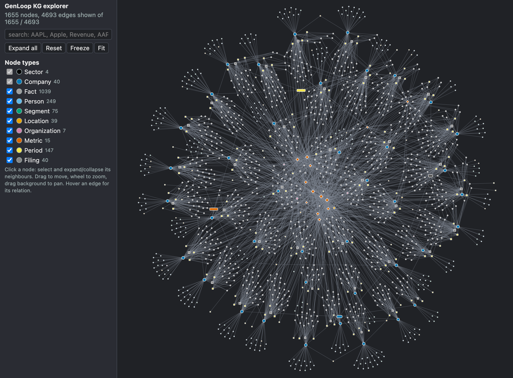

# Knowledge graph views

*The GenLoop knowledge graph built from the 40 10-K filings (sectors, companies, facts with doc and page, entities).*

**`explorer.html`** is the interactive explorer: all nodes and edges from `graph/kg.json`, single file (~1.6 MB, vis-network 9.1.9 inlined, works offline on `file://`). Starts with Sectors + Companies; click a node to expand/collapse its neighbours, the side panel shows all attributes (Fact: value, unit, period, doc, page, snippet, validated, xbrl_status, method) and clickable neighbours; type checkboxes, search (`AAPL`, `Apple`, `Revenue`, `AAPL|Revenue|FY2025`), Expand all / Reset / Freeze / Fit; hover an edge for its relation. Test hooks: URL hash `#expand=AAPL`, `#search=...`, `#all=1`, `#collapse=ID`.

Static views: `overview.png` (sectors, companies, entities), `schema.png` (node and edge types with counts).

Regenerate from `graph/kg.json`:

    .venv/bin/python scripts/render_kg.py   # template: scripts/explorer_template.html; lib cached in .cache/ (downloaded once)
